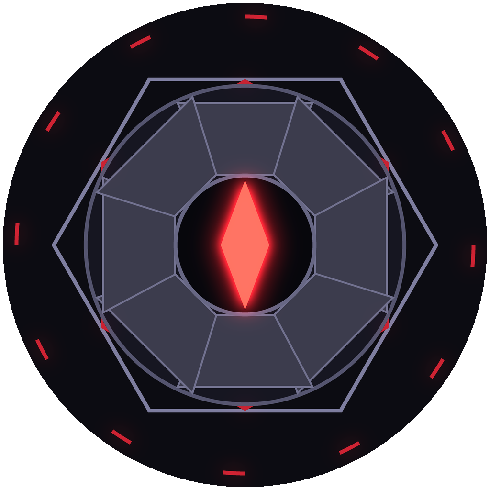

# ULTRON



ULTRON "Sentinel Core" is a desktop AI console for Windows. It talks to Anthropic, OpenAI or Groq using your own API key, keeps your account, chats and settings on your PC, and has a global hotkey (Ctrl+Shift+U).

Download the installer from the [Releases](../../releases) page. It's also included in the all-in-one [Assistants](https://github.com/KrishivDaFih/Assistants) setup.

## What's new in 1.1.1

- Brighter app logo: the steel frame and plates are lifted and the red core glows more, so the icon reads clearly on the taskbar, Start Menu and desktop.

## Project layout

| Path | What it is |
|------|------------|
| `app/main.js` | Electron main process (window, hotkey, providers) |
| `app/preload.js` | Bridge between the UI and the main process |
| `app/app/index.html` | The ULTRON console UI |
| `app/settings.html` | Settings window |
| `app/app.config.json` | Product name, app ID, theme colours |
| `app/icon.png` | Window and taskbar icon |
| `build/` | Installer icon, license/terms page |

## Building

```
npm install
npx electron-builder --win nsis --x64
```

The installer is written to `dist/ULTRON-Setup-<version>.exe`.

Unofficial fan project, not affiliated with or endorsed by Marvel, Disney, Anthropic, OpenAI or Groq.
